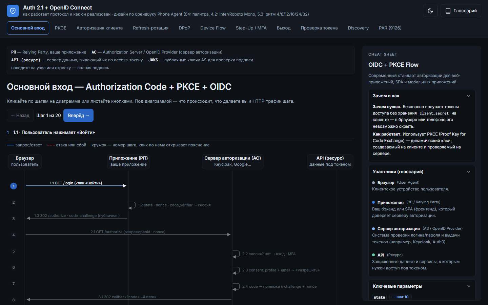
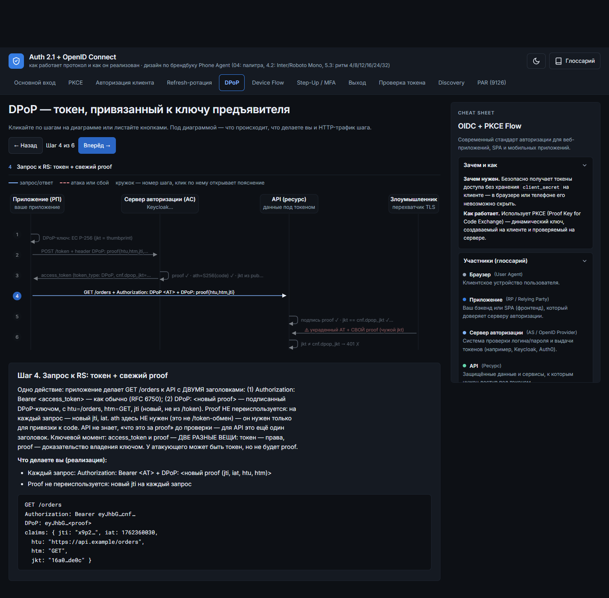

# Auth 2.1 + OpenID Connect — интерактивный конструктор потоков

> Как работает OAuth 2.1 / OIDC — и как это реализовать. 11 интерактивных диаграмм последовательности, 74 атомарных шага, HTTP-трафик каждого шага. Один HTML-файл без зависимостей.

**Живая версия:** [gustafor.github.io/Auth_2.1_Online_Constructor](https://gustafor.github.io/Auth_2.1_Online_Constructor) · **Приложение:** [`course/auth21-diagrams.html`](course/auth21-diagrams.html)




## Почему это нужно

В спецификациях (RFC 6749, 7636, 8252, 8628, 9126, 9449, 9470, 9700 и OIDC Core) описано *что* происходит, но не *как это реализовать* без дыр. Каждый шаг здесь отвечает на три вопроса:

1. **Что происходит** — механика протокола с точными RFC-ссылками;
2. **Что делаете вы** — конкретные действия реализации (CSPRNG, `crypto.timingSafeEqual`, TTL, single-use, ротация…);
3. **HTTP-трафик** — реальные запросы/ответы, которые должен отдавать/принимать ваш код.

Атаки и сбои показаны красными пунктирными стрелками — вы видите, *что именно* ломается, если шаг не реализован.

## Диаграммы (11)

| # | Вкладка | Что показывает | Шагов |
|---|---|---|---|
| 1 | Основной вход | Authorization Code + PKCE + OIDC, полный цикл | 20 |
| 2 | PKCE | `code_verifier`/`code_challenge` (S256) против перехвата кода | 7 |
| 3 | Авторизация клиента | confidential-клиент: `client_secret`, `private_key_jwt`, mTLS | 5 |
| 4 | Refresh-ротация | ротация refresh-токенов и reuse detection | 5 |
| 5 | DPoP | sender-constrained токены (RFC 9449) против кражи AT | 6 |
| 6 | Device Flow | вход с устройства без браузера (RFC 8628), `slow_down` | 6 |
| 7 | Step-Up / MFA | `prompt=login`, `require_step_up`, ACR (RFC 9470) | 5 |
| 8 | Выход | RP-Initiated Logout + Back-Channel Logout | 5 |
| 9 | Проверка токена | локальная валидация JWT: подпись, JWKS, claims | 6 |
| 10 | Discovery | `/.well-known/openid-configuration`, JWKS, Dynamic Registration | 5 |
| 11 | PAR (9126) | Pushed Authorization Requests против подмены запроса | 4 |

## Структура репозитория

```
├── index.html                        # приветственная страница (GitHub Pages)
├── README.md
├── robots.txt                        # разрешение LinkedInBot и других парсеров
└── course/
    ├── auth21-diagrams.html          # приложение: 11 диаграмм, офлайн, без зависимостей
    ├── Auth2.1-все-диаграммы-шаги.md # все 11 диаграмм и 74 шага одним Markdown
    ├── Брендбук-auth21-diagrams.md   # брендбук приложения (токи, ритм, антипаттерны)
    ├── og-cover.jpg                  # обложка 1200×630 (Open Graph / LinkedIn)
    └── screenshots/
        ├── shot-dark-core.png        # скрин: Основной вход, шаг 1
        └── shot-dpop.png             # скрин: DPoP, атака перехвата
```

## Как открыть

Просто открыть `course/auth21-diagrams.html` в браузере — никаких зависимостей, серверов и сборки. Либо через GitHub Pages (корневой `index.html` — витрина).

## Как пользоваться

- **Клик по шагу на диаграмме** (или по полосе) — открывает пояснение;
- **← Назад / Вперёд →** — листание шагов, счётчик «Шаг N из M»;
- **Под диаграммой** — что происходит, что делаете вы, HTTP-трафик;
- **Cheat Sheet** (правый сайдбар) — ключевые параметры, payloads с кнопкой копирования, связь «→ шаг N»;
- **Глоссарий** — кнопка книги в шапке, 50+ терминов с поиском;
- **Тема** — лунка/солнце в шапке; **мобильный режим** — диаграмма превращается в список шагов.

## Дизайн

Приложение собрано по брендбуку **Phone Agent**: графитовая тёмная тема (`#0d1015`), Inter + Roboto Mono, ритм 4/8/12/16/24/32, радиусы 4–12px, семантика цвета (синий = действие, зелёный = успех, красный = опасность, янтарный = ожидание), плоскость без градиентов и теней. Полный токен-спец — [`course/Брендбук-auth21-diagrams.md`](course/Брендбук-auth21-diagrams.md).

## Open Graph / превью в соцсетях

Обложка 1200×630 — [`course/og-cover.jpg`](course/og-cover.jpg) (JPG, абсолютный `https://` URL в `og:image`). `robots.txt` разрешает `LinkedInBot`, `Twitterbot`, `facebookexternalhit` и прочие парсеры. После публикации ссылки в LinkedIn, если превью не подтянулось — прогоните URL через [LinkedIn Post Inspector](https://www.linkedin.com/post-inspector/) для сброса кэша.

## Лицензия

MIT
