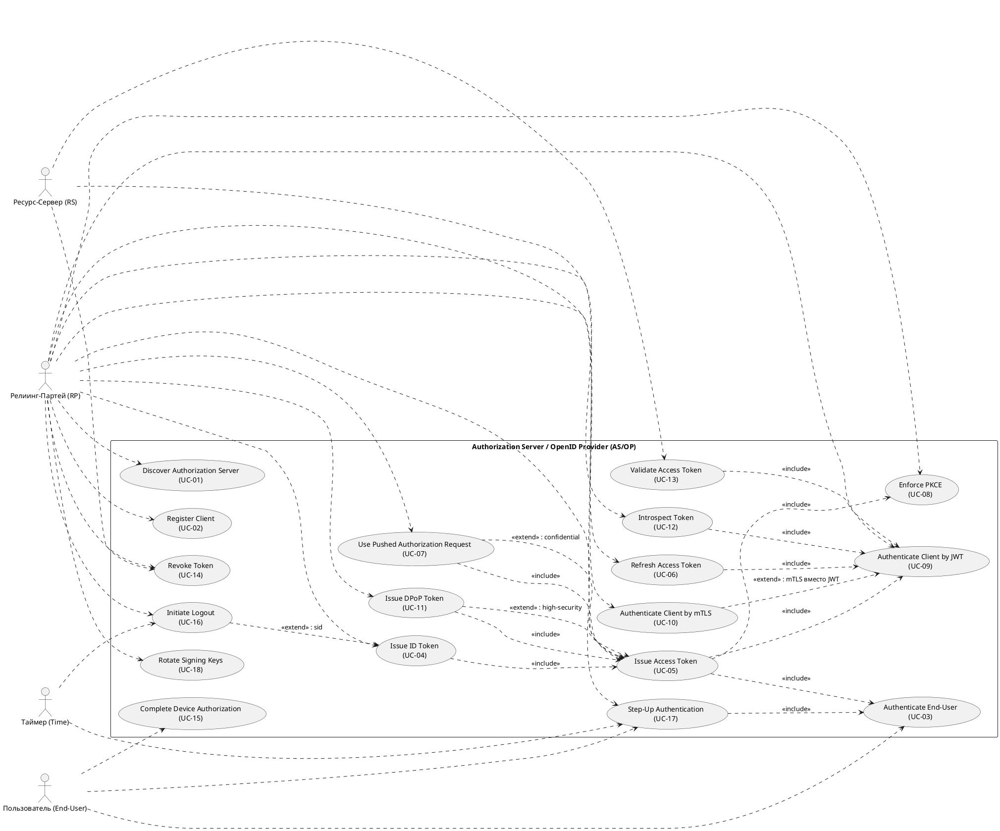

# Use Case Diagram — Authorization Server / OpenID Provider (AS/OP)

Система (чёрный ящик): AS/OP. Актеры: Релиинг-Партей (RP), Пользователь
(End-User), Ресурс-Сервер (RS), Таймер (Time).

## Проверки диаграммы
- [x] каждый актор связан ≥ 1 UC: RP (13 UC), End-User (UC-03/15/17),
      RS (UC-12/13/14), Таймер (UC-16/17), AS/OP/UC-18 (внутренний).
- [x] граница системы совпадает с scope (AS/OP чёрный ящик).
- [x] направление include/extend корректно (стрелка — к включаемому/базовому).
- [x] 18 UC — допустимо (упаковано в один пакет; при необходимости делить
      по подсистемам: discovery / токенизация / logout / keys).
